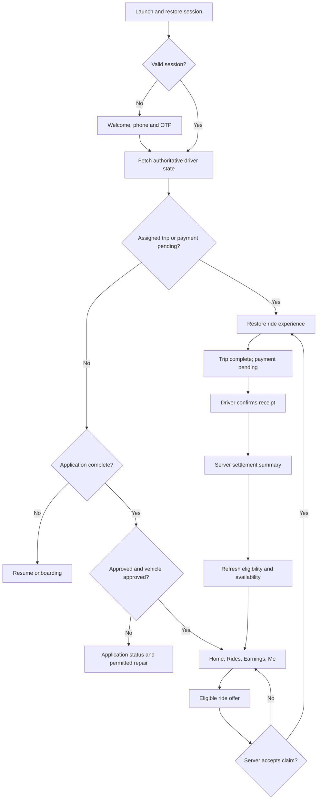

# Cabzone Driver App — Pages, Components, Navigation and Implementation Plan

**Updated:** 2026-10-14  
**Application:** `apps/driver-mobile`  
**Framework:** React Native with Expo and Expo Router  
**Status:** Implementation guide; planned routes and components are not claims of completion  
**Scope:** Driver registration, verification, availability, dispatch, trip execution, direct payment confirmation, earnings and account management

**Implementation note:** The route tree and ride context began landing as uncommitted work after the baseline inspection for this document. Recheck the live tree and checks before using the status tables as a completion report.

## 1. Purpose and source of truth

This document translates the agreed Driver App scope into an implementable page structure, reusable components, navigation rules and backend integration tasks. It records the current baseline so engineers can extend the existing app without duplicating its onboarding flow or creating screens that have no operational behavior.

The backend owns identity, approval, vehicle eligibility, availability, ride assignment, ride transitions, fares, commission and wallet accounting. Routes and animations display those decisions; they never authorize them.

Read this guide alongside:

- [Driver technical specification](driver-app-spec-v1.md).
- [Onboarding flow audit](driver-onboarding-flow-audit.md).
- [Ride lifecycle](../LLD/ride-lifecycle.md).
- [Wallet and commission](../LLD/wallet-and-commission.md).
- [Dispatch engine](../LLD/dispatch-engine.md).
- [WebSocket contracts](../LLD/websocket-contracts.md).
- [Decision log](../decision-log.md).

Some existing documents contain older conceptual state names or commission wording. For implementation, use the shared contracts and current backend validators. Do not introduce a second ride state machine from a diagram.

## 2. Product decisions and boundaries

| Area | Decision and implementation consequence |
| --- | --- |
| App identity | Display name is `Cabzone: Driver`; use the supplied Cabzone logos and existing brand assets. |
| Theme | Plain white backgrounds, solid amber primary actions and deep brown text. Earlier sky-blue/light-grey wording does not govern this implementation. |
| Primary navigation | Home, Rides, Earnings and Me after authentication and onboarding. |
| Onboarding | Save progress per authenticated user; reconcile saved drafts with server documents and application status. |
| Driver/passenger separation | No passenger mode or passenger-mode switch in this app. |
| Vehicle scope | Cab city/outstation operation is the current active path. E-Rickshaw city-only support is a target capability, currently staged in the shared category registry and app. |
| Dispatch | First successful server acceptance wins. No counter-offer, auction, auto-accept or local winner calculation. |
| Realtime and push | Authenticated WebSocket is the primary live channel. FCM-backed Android push is required for background/offline-socket alerts. Opening a notification always triggers a server refresh. WebRTC is outside this dispatch design. |
| Rider payment | Cash or direct payment to the driver's personal UPI. A driver's receipt confirmation is a declaration, not bank verification. |
| Commission | Product target is 8%; display authoritative amounts from the ride's pricing snapshot and settlement response. Never recalculate historical commission using a current setting. |
| Settlement timing | Completing the trip and confirming payment are separate commands. Commission is posted after driver receipt confirmation. |
| Rider dispute | If the admin resolves in the rider's favour, refund the commission through a new ledger entry. Otherwise retain it. The mobile app displays the server result. |
| Pricing | Specific city pricing overrides applicable state pricing, which overrides global pricing. Interstate outstation distance uses separate state-segment rates according to the agreed backend policy. The app displays the resulting fare. |
| Providers | SMS/KYC-provider selection and wallet top-up-provider integration were deferred. Cloudinary is configured according to the prior project work; deployment configuration still needs environment-specific verification. |
| Redis | Docker/Redis setup is deferred. In-memory development presence is not evidence that multi-instance production dispatch is ready. |
| Help and safety | Expose operationally supported contact/report actions. Do not promise 24/7 support, SOS response, payouts or bonuses without an actual service behind them. |

Do not enable a staged vehicle category only by changing its mobile label. Category activation must include backend document requirements, eligibility, city-only restrictions and dispatch tests.

## 3. Current implementation baseline

This is a source inspection baseline from 2026-10-14, not a hardware acceptance result.

| Capability | Current evidence | Remaining work |
| --- | --- | --- |
| App launch | `app.json` has the driver display name and icon/splash asset references; an animated splash component exists. | Verify actual installed icons, splash and bootstrap failure states on Android. |
| Authentication | `auth-context.tsx` and `services/api.ts` call request OTP, verify OTP, refresh and logout APIs. | Preserve sessions on temporary network/server failures; centralize authenticated-request refresh and retry. |
| Profile and onboarding | Existing wizard, profile helpers, photo selection, document uploads, submission and status screens. | Preserve these integrations when introducing routes; verify rejection/resubmission and refresh failures end to end. |
| Onboarding persistence | Wizard restores user-specific local drafts and merges authoritative server data. | Verify interrupted upload/save, restored step and account switching. |
| Availability | Duty context sends online/offline commands and foreground location updates. | Remove false GPS fallback, restore server availability, add background operation and reconciliation. |
| Home summary | Wallet API and summary display exist. | Replace wallet-credit-derived earnings and transaction-type-derived ride counts with proper earnings data. |
| Ride offers | An existing `CabzonRideOffer` visual component exists; backend lists and publishes offers. Uncommitted mobile ride-context work now polls offers. | Authenticated socket client, immediate offer removal, expiry reconciliation and complete acceptance recovery. |
| Trip execution | Backend exposes accept, en-route, arrival, OTP start, complete and cancel. Uncommitted mobile ride-context/routes now call several commands. | Review, validate and test the actual operational journey and restart recovery. |
| Payment/dispute | Backend completion, receipt confirmation and dispute resolution use cases exist. | Mobile payment UI, method recording contract, UPI configuration and accurate settlement summary. |
| Wallet/history | Driver wallet read and backend ride listing exist. | Earnings, ledger UI, history filters/details and paginated data contracts. |
| Main navigation | Four-tab and detail route files have been added as uncommitted work since this document's initial inspection. | Verify route guards, active-ride priority, account details and real-device navigation. |
| Notifications | Backend ride notifier and an uncommitted Expo push sender/token API exist. | Client token acquisition/registration, Android permissions/configuration, persistent token storage, background delivery and notification entry/resync. |
| Tests | Driver app has profile helper tests. | State recovery, route guards, command races, money presentation and real-device workflow checks. |

Existing backend routes are building blocks. Their presence does not prove the complete mobile journey is implemented or release-ready.

## 4. App architecture



An active assignment or unresolved payment must be recoverable even if the driver's approval or wallet eligibility subsequently changes. Restrictions prevent new work; they must not erase an existing trip or prevent the permitted settlement/help workflow.

The main tabs remain available as the normal application structure. On acceptance and app restoration, open the active-ride experience automatically. If the driver navigates to Help or another permitted screen, retain a visible return-to-ride action. Do not disable Android Back without a specific reason.

## 5. Proposed Expo Router route tree

Keep route files thin: load/guard the feature state and render the relevant screen. Expo Router remains the only navigation system.

```text
src/app/
├── _layout.tsx                       Shared providers, root stack, splash
├── index.tsx                         Bootstrap and authoritative routing gate
├── (auth)/
│   ├── _layout.tsx                   Public auth stack
│   ├── welcome.tsx                  WelcomeScreen
│   ├── phone.tsx                    LoginScreen
│   └── otp.tsx                      OTPVerificationScreen
├── (onboarding)/
│   ├── _layout.tsx                   Authenticated application guard
│   ├── onboarding.tsx               Existing wizard with resumable steps
│   └── application-status.tsx       Pending/rejected/approved states
└── (driver)/
    ├── _layout.tsx                   Driver guard and detail stack
    ├── (tabs)/
    │   ├── _layout.tsx               Expo Router Tabs
    │   ├── home.tsx                  Operational home
    │   ├── rides.tsx                 Current ride and history
    │   ├── earnings.tsx              Earnings overview and wallet entry
    │   └── me.tsx                    Profile and account menu
    ├── ride/
    │   └── [rideId].tsx              Authoritative active-ride screen
    ├── history/
    │   └── [rideId].tsx              Read-only ride detail
    ├── wallet.tsx                    Wallet balance and ledger
    ├── transaction/
    │   └── [transactionId].tsx       Transaction detail, if API supports it
    └── account/
        ├── personal-details.tsx
        ├── vehicle.tsx
        ├── documents.tsx
        ├── document-details.tsx
        ├── notifications.tsx
        ├── help.tsx
        └── legal.tsx
```

This tree was proposed before route files began landing in the worktree. Check actual files before creating another route. Route groups do not create URL path segments. Keep unique actual route paths; avoid multiple group-level `index.tsx` files resolving to the same path.

The onboarding wizard may remain one route with several steps. It does not need a physical route for every field or upload. Likewise, one `ride/[rideId]` route can render pickup, arrival, trip and payment states from the current server status.

Do not create a functional-looking recharge route until top-up is enabled and an authoritative provider-confirmation flow exists.

### Navigation guard instructions

1. Read stored session credentials and restore the session.
2. Distinguish an expired/revoked credential from a network timeout or temporary server failure. Clear credentials for confirmed invalid sessions, not every fetch failure.
3. Fetch driver profile, application/vehicle/document state and current operational state.
4. Restore an assigned ride or pending payment before routing to general onboarding/status/home views.
5. Otherwise choose authentication, onboarding, application status or tabs based on server data.
6. Guard nested routes and notification links as well as the root entry route.
7. Use route replacement when switching identity/approval gates so Back cannot reveal a previous account's screen.
8. Clear account-specific caches, drafts in memory, sockets and telemetry when identity changes.
9. Treat a deep-linked ride ID as untrusted. Fetch the ride and let the backend enforce ownership before showing private details.

## 6. Page inventory and responsibilities

### 6.1 Authentication and onboarding

| Screen/state | Components and behavior | Data and completion condition |
| --- | --- | --- |
| Splash/bootstrap | Logo, short loading state, retry when restoration fails. | Remains until session and authoritative routing state are known. |
| Welcome | Brand illustration, short headline, Become a Driver, Log in. | Both actions enter the approved OTP flow; no separate fabricated registration session. |
| Phone entry | `PhoneField`, +91 prefix, validation, primary action and inline error. | Request OTP through existing API; distinguish cooldown/rate-limit/network errors. |
| OTP verification | `OtpInput`, resend timer, verify loading and error. | Authentication currently uses six digits. Never confuse it with the four-digit ride-start OTP. |
| Personal information | Name, DOB, gender, profile photo and policy-required fields. | Save existing backend fields; ISO birth date and shared enum values. |
| Operating city | Existing city-selection step and coverage messaging. | Preserve the current step; do not claim a requested area is active or dispatchable. |
| Vehicle type/details | Cab/E-Rickshaw status, registration, make, manual model and colour. | Register approved category/fields through backend; preserve manual input and shared category status. |
| Driving licence | File picker/capture entry where supported, file summary, replace, number and expiry. | PDF/JPG/JPEG, maximum 500 KB; server document record determines uploaded status. |
| Vehicle documents | RC, insurance, permit and other currently required identity documents. | Use actual backend requirements; do not omit a required item merely because this page list is shorter. |
| Profile photo/selfie | Existing image selection and profile save. | Do not treat a profile photo as a verified selfie document unless backend policy explicitly does so. |
| Review | Personal, vehicle and document summaries with targeted Edit actions. | Submission requires authoritative stored documents and valid permitted fields. |
| Application status | Pending, rejected, action required, approved and refresh/error states. | Display backend reason and permitted next action; local state never grants approval. |

### 6.2 Main tabs

| Tab | Purpose | Main screen sections | Detail destinations |
| --- | --- | --- | --- |
| Home | Availability and immediate work. | Availability card, current trip, eligibility warnings, connection/location status, daily stats. | Active ride, required permission/settings action, account repair. |
| Rides | Current work and history. | Current ride card, completed/cancelled lists, filters and pagination. | Active ride or read-only history detail. |
| Earnings | Understand earnings and commission liabilities. | Period selector, gross/commission/net totals, completed count and wallet summary. | Wallet ledger and supported transaction detail. |
| Me | Account ownership and assistance. | Profile header, personal details, vehicle, documents, help/legal and logout. | Account detail screens. |

Tabs retain appropriate scroll/filter state when switching. Safe-area and bottom-tab height must be included in scroll padding. A screen must not hide its final row or CTA under the Android navigation bar.

### 6.3 Home states

Home is one screen with conditional states. Do not create separate unrelated offline and online pages.

| State | Required UI | Action rule |
| --- | --- | --- |
| Offline | Offline label, Go Online, daily summary and restrictions. | Request fresh location and server eligibility before declaring online. |
| Going online | Busy primary action and concise progress text. | Prevent duplicate commands; do not animate a success before server response. |
| Online, no ride | Availability, fresh location, connection status and offers. | Receive/pull current eligible offers. |
| Assigned ride | Prominent current ride card and Resume Ride. | Do not show the driver as free for another assignment. |
| Payment pending | Payment action and unresolved status. | Fetch authoritative trip before confirming receipt. |
| Restricted | Backend reason, actionable repair/help link and existing trip access. | Restriction does not clear trip ownership. |
| Location unavailable | Permission/GPS/accuracy explanation. | Never send invented coordinates. |
| Reconnecting | Connection banner and pending-state feedback. | Resync before declaring dispatch-ready. |

## 7. Ride experience and actual backend states

Use the current `RideStatus` contract, not conceptual labels such as `ACCEPTED`, `ARRIVED` or `IN_PROGRESS` as new persistent enums.

| Server state | Driver UI | Permitted next interaction |
| --- | --- | --- |
| `OFFERING` | RideOfferSheet for an eligible offer. | Accept or locally dismiss; server validates expiry and claim. |
| `DRIVER_ASSIGNED` | Accepted acknowledgement and pickup details. | Start pickup navigation/en-route command. |
| `DRIVER_EN_ROUTE` | NavigateToPickupScreen state. | Mark arrived; contact/help/cancel where permitted. |
| `DRIVER_ARRIVED` | ArrivedScreen state with four-digit OTP input. | Server OTP verification and trip start. |
| `TRIP_STARTED` | ActiveTripScreen state. | Destination navigation and trip completion. |
| `TRIP_COMPLETED` | Intermediate completion state if returned. | Re-fetch and follow server payment state; do not invent a transition. |
| `PAYMENT_PENDING` | PaymentConfirmationSheet and unresolved-payment details. | Driver receipt declaration through confirmation endpoint. |
| `PAYMENT_CONFIRMED` | Intermediate confirmation state if returned. | Refresh settlement; do not post a second local debit. |
| `SETTLED` | RideCompletionScreen or history detail. | Display returned money values; refresh wallet/eligibility. |
| `PAYMENT_DISPUTED` | Payment under review with support/status entry. | Display permitted backend outcome; driver does not resolve the dispute. |
| `CANCELLED` | Cancellation outcome and applicable server-defined fees. | Reconcile availability and return to shell. |
| `EXPIRED` | Offer unavailable/expired feedback. | Dismiss and refresh available offers. |

The current completion use case moves the started ride to payment pending. Confirmation settles it. The UI must handle these observed states instead of assuming every conceptual intermediary will be separately visible.

### Ride offer sheet

- Show pickup, destination, proposed fare, category, distance to pickup and expiry from the actual offer DTO.
- Show trip distance, duration, classification and pickup ETA only when the backend returns them or a supported route lookup supplies them.
- Current offer mapping includes ride ID, category, pickup/drop, proposed fare, pickup distance and expiry. It does not currently expose every metric in the proposed design.
- Calculate a display countdown from server expiry, but always let the accept endpoint decide validity.
- Disable Accept while a claim is pending. On timeout, fetch authoritative ride/assignment state before allowing another claim.
- If another driver wins, show Ride already taken and dismiss the stale offer.
- Ignore may be a local dismissal in MVP; no existing driver-ignore endpoint was identified in the inspected dispatch router. Document whether suppression lasts until expiry, session end or a backend policy.
- Local suppression must never block recovery of a ride that the server has already assigned to this driver.
- Reuse the existing `CabzonRideOffer` as the visual starting point; adapt its data input to actual shared contracts.

### Pickup, arrival and OTP

- Show ride reference, agreed fare, addresses, category and current server status throughout.
- External navigation must return to the same authoritative ride. Opening maps is not proof that an en-route command succeeded.
- Arrival is a backend transition; surface location/proximity rejection clearly.
- Ride OTP is four digits under the current validator. Authentication OTP is six digits.
- Never expose a hidden rider OTP to the driver from events/cache. The backend notifier deliberately sends it only to the rider.
- On invalid/expired/locked OTP, show the backend error and permitted retry/help action.
- If the request times out after trip start, fetch the ride before resubmitting.

### Active trip, completion and payment

- Destination and navigation remain visible even if the embedded map fails.
- Prevent invalid cancellation controls during a started trip. Follow backend termination/help policy.
- Complete Ride first moves the trip into payment pending; it does not mean cash/UPI was received.
- Show agreed fare and a clear declaration: Payment received from rider.
- Payment not received must retain the unresolved server state and expose supported help. Do not label the existing post-settlement rider-dispute endpoint as a driver non-payment workflow.
- Cash versus personal UPI method recording and driver QR configuration need a verified contract. The inspected confirm-payment controller calls the use case with ride ID and authenticated driver ID, without a method field.
- Do not create a bank-verification badge or display a locally generated UPI success as payment confirmation.
- Settlement summary uses server gross fare, commission, status and wallet result. If net earnings are not returned, request an earnings contract or clearly label any derived display as a calculation rather than a ledger posting.
- Done refreshes the wallet, ride lists and availability; request new offers only if the server still permits dispatch.

### Cancellation and no-show

- Use shared cancellation reasons and server allowed transitions.
- Show confirmation, submit once, then reconcile final ride state.
- If cancellation races with start/completion, display the newer server state.
- Show fees, waiting time and no-show availability only when defined by backend policy.
- Do not start a client-only timer and authorize a no-show from it.

## 8. Component system and ownership

Reuse the current brand components before creating replacements. Do not build a generic component library for features that are not used.

| Component family | Existing starting point | Planned responsibility |
| --- | --- | --- |
| Screen layout | SafeAreaProvider, existing safe-area screens and scroll patterns. | `AppScaffold` and `ScreenHeader` for consistent inset, keyboard and loading/error behavior. |
| Buttons | `CabzonButton`, `CandyButton`. | Prefer one branded primary-action API; use loading/disabled states and accessible labels. |
| Forms | Existing personal/vehicle/OTP fields. | Extract a TextField/PhoneField/OtpInput only when reused, preserving validation and keyboard behavior. |
| Feedback | Existing toast, status, progress, loading, success and error components. | Share InlineError, ErrorState and EmptyState; avoid duplicate message systems. |
| Status | Existing status indicator. | Accessible badges for ride/KYC/document status; text plus icon, not colour alone. |
| Offers | Existing `CabzonRideOffer`. | Offer content, pending claim, expiry and unavailable feedback. |
| Home | Existing `DriverHome`. | Extract AvailabilityStatusCard, DailyStatsCard, EligibilityChecklist and ActiveRideCard as behavior grows. |
| Documents | Existing DL/vehicle/photo screens and file helpers. | Reuse file validation and summaries; server document status remains separate from file selection. |
| Maps | No complete wired driver ride-map flow in the inspected source. | RideMap, markers and RouteSummary backed by returned coordinates/routes. |
| Sheets/dialogs | Existing modal interactions. | Offer/payment/cancellation/confirmation UI with focus, Back dismissal and safe-area handling. |
| History/money | New operational components. | RideListItem, RideStatusBadge, WalletBalanceCard, TransactionListItem and period selector. |

Keep HomeHeader, availability controls, eligibility checklist, connection/location banners and daily summary within driver-home ownership. Keep ride route summaries, fare rows, OTP state and cancellation/payment sheets within ride ownership. Move a component to shared UI only after more than one feature genuinely needs it.

### Component interface rules

- Visual components receive typed display data and callbacks; they do not call arbitrary endpoints.
- Screen/hooks own queries and commands; services own transport.
- Expose pending/error state explicitly so buttons and sheets cannot imply success.
- Reuse DTOs and enums from `@cabzone/contracts`; do not replace them with `any` or a second set of financial/status models.
- Keep money in integer paise until formatting; label gross earnings, commission and wallet balance separately.
- Derive display state from server data. Do not maintain a second permanent local ride status next to the fetched ride.

## 9. Layout, forms, scrolling and accessibility

### Visual rules

- Screen and card surfaces use plain white `#FFFFFF`.
- Primary CTA uses solid amber; the existing token is `colors.amber` (`#FBBF24`). No gradient CTA.
- Primary CTA text and main text use deep brown `#3A2414` with verified contrast.
- Supporting tints can highlight warnings or selected controls; do not turn the full page cream.
- Reuse `design-system/typography.ts`, spacing and motion tokens. Audit hard-coded legacy blue/narrow font values as screens are touched.
- Show meaningful status text beside success/warning/error colour.
- Respect reduced-motion preferences. Animation must not delay accepting, starting, confirming or retrying a ride command.

### Forms and keyboard

- Persistent labels remain visible after entering data.
- Display field errors beside the affected field; use a submission summary only for multiple/server-level failures.
- Phone, numeric plate-related fields and OTP use suitable keyboards without blocking valid characters.
- Set appropriate autofill hints; never autofill the ride OTP with the authentication code.
- Preserve all valid typed values when changing a preset, selecting a model or retrying a request.
- Validate dates strictly; use existing profile validation helpers and the backend's policy.
- Ensure keyboard avoidance, scroll-to-error and focused-field visibility on small Android devices.
- A fixed bottom CTA needs scroll padding equal to its height plus safe-area inset; keyboard opening must not cover the final input.

### Scroll and sheets

- Prefer one vertical scroll container per full-screen form.
- Avoid nesting a vertical virtualized list in a vertical ScrollView. Ride and transaction histories use appropriate virtualized lists.
- Include loading/empty/error content within the same usable screen layout.
- Long document names, addresses, rejection reasons and translated text must wrap without covering actions.
- Sheets must have a maximum usable height, internal scrolling where needed and a visible close/back action.
- Upload progress must remain visible during scrolling and must not freeze the whole form unnecessarily.

### Accessibility and device verification

- Buttons have accessible names, roles and disabled/busy states.
- Touch targets should be at least 48 device-independent pixels for primary controls on Android.
- Support font scaling without clipping fares, OTP boxes or tab labels.
- Announce meaningful errors and state changes; do not announce each countdown tick.
- Test Android Back, keyboard dismissal, screen-reader focus and safe-area handling on the user's physical device.

## 10. Feature folders and migration approach

Preserve current files initially; extract a feature when building its real behavior. A route migration does not require moving every component first.

```text
src/
├── app/                         Expo Router routes only
├── context/                     Existing authentication/duty providers
├── features/                    Add incrementally
│   ├── driver-home/
│   ├── dispatch/
│   ├── rides/
│   ├── earnings/
│   ├── wallet/
│   └── account/
├── components/                  Existing shared and onboarding components
│   ├── auth/
│   ├── kyc/
│   ├── buttons/
│   ├── feedback/
│   └── cards/
├── services/
│   ├── api.ts                   Existing transport; add typed commands
│   ├── storage.ts               Secure/session and draft helpers
│   ├── profile.ts               Existing validation/mapping
│   ├── driver-license.ts        Existing file selection/read helpers
│   ├── realtime.ts              Add when connected to actual transport
│   └── location.ts              Extract actual location lifecycle
└── design-system/               Existing colours, typography, spacing, motion
```

Do not put feature implementation folders such as `providers/` or `navigation/` under `app/` where Expo Router can interpret them as route files. Keep provider logic in context/services or a non-route feature folder.

## 11. Backend integration map

All paths below are API paths, separate from mobile routes. Confirm request/response DTOs against the source before implementing a caller.

| Capability | Existing backend route | Mobile task |
| --- | --- | --- |
| OTP request/verify | `POST /api/v1/auth/otp/request`, `POST /api/v1/auth/otp/verify` | Preserve existing callers and meaningful API errors. |
| Refresh/logout | `POST /api/v1/auth/refresh`, `POST /api/v1/auth/logout` | Centralize refresh; revoke and clean local resources on logout. |
| Driver profile | `GET /api/v1/driver/profile/me`, `POST /api/v1/driver/profile` | Reuse existing profile mapping and permitted-field saves. |
| Application | `POST /api/v1/driver/application`, `POST /api/v1/driver/application/submit` | Keep duplicate-safe creation/submission and post-submit reconciliation. |
| Vehicle | `POST /api/v1/driver/vehicles` | Verify edit/reverification behavior before exposing approved-vehicle changes. |
| Document files | `POST /api/v1/driver/documents/license`, `/documents/vehicle`, `/documents/identity` | Reuse existing upload validation and server records. |
| Availability | `POST /api/v1/driver/status` | Restore/display authoritative state; handle denied transitions. |
| Location | `POST /api/v1/driver/location` | Fresh real coordinates, bounded reporting and lifecycle cleanup. |
| Offers | `GET /api/v1/driver/offers` | Add typed pull/resync caller and offer controller. |
| Ride list/detail | `GET /api/v1/rides`, `GET /api/v1/rides/:id` | Add owned-ride fetching, current-ride recovery and paginated history. |
| Ride events | `GET /api/v1/rides/:id/events` | Use for supported audit/detail display, not as the sole current-state source. |
| Accept | `POST /api/v1/rides/:id/accept` | Pending state, race/conflict feedback and uncertain-result reconciliation. |
| Approach/arrival | `POST /api/v1/rides/:id/en-route`, `POST /api/v1/rides/:id/arrived` | Pickup progression from returned state. |
| Start | `POST /api/v1/rides/:id/start` | Four-digit OTP; current validator accepts `otp`. Identity comes from authentication. |
| Complete | `POST /api/v1/rides/:id/complete` | Payment-pending transition; no receipt declaration implied. |
| Confirm receipt | `POST /api/v1/rides/:id/payment/confirm` | Settlement result and wallet refresh; verify method-recording extension if required. |
| Cancel | `POST /api/v1/rides/:id/cancel` | Shared reason enum and authoritative final-state handling. |
| Driver wallet | `GET /api/v1/driver/wallet/me` | Real loading/error/empty states and ledger display. |
| Rider dispute/admin resolution | Existing ride payment-dispute endpoints. | Driver shows outcome; do not expose admin/rider-only commands as driver actions. |

### Contracts that need work or explicit verification

1. **Operational bootstrap:** Reliable driver-scoped availability and current-trip retrieval, including pending payment. The current status router exposes commands and offers, not a dedicated status read. Decide whether profile/list endpoints already provide everything or extend one existing contract.
2. **Offer richness:** Trip distance/duration, category/service classification and pickup ETA are not all present in the inspected offer mapping. Extend shared DTO/backend mapping if the offer UI requires them.
3. **Earnings:** Period totals must represent completed/settled rides and actual commission, not wallet credits. Current ride-list filters include status and limit/offset, but do not demonstrate the required date-range aggregation contract.
4. **Ledger history:** Verify the wallet response's transaction limit and pagination before exposing full history. A single wallet read is not proof of complete history.
5. **Payment method and QR:** Establish permitted driver UPI configuration, method recording and historical receipt-method display.
6. **Document read/preview:** Secure document-detail access and renewal/rejection editing after approval require verified API behavior.
7. **Notifications/preferences/support/legal:** Verify real registration, preference persistence, issue-submission endpoints and operational/legal content. These are not established by an attractive menu.
8. **Top-up:** Disabled until an actual provider callback and idempotent credit path exist.

For each missing contract, record request, response, ownership, validation, error codes and retry behavior before writing a screen that depends on it. Extend existing modules; do not create parallel wallet or ride systems.

## 12. Client state, realtime and recovery

### State responsibilities

| State | Owner | Client handling |
| --- | --- | --- |
| Session | Auth backend and secure device storage. | Restore/refresh/revoke; no plaintext secret logging. |
| Application/profile/documents | Identity backend. | Cached display plus scoped local incomplete draft. |
| Availability | Dispatch backend. | Display confirmed status; reconcile after restart/reconnect. |
| GPS/permission/connection | Device with backend freshness validation. | Explain issues and publish real locations only. |
| Offer validity/assignment | Dispatch and rides backend. | Expiry display and command/re-fetch handling. |
| Ride/settlement/wallet | Backend. | Invalidate/refetch on commands and events. |
| Selected tab/filter/open sheet | Client. | Local UI state; no business authorization. |

### API client instructions

- Keep status, error code and request ID available to callers. A generic message-only Error prevents reliable handling of expired sessions, conflicts and rate limits.
- Coordinate concurrent refresh attempts through one shared refresh operation; do not rotate the same refresh token independently for each request.
- Retry an authenticated read once after successful refresh. For uncertain mutation results, fetch state before replaying.
- Use timeouts/cancellation and check account/ride identity before applying a late response.
- Never silently convert a failed wallet request to a zero balance. Show an unavailable/retry state and retain previously fetched data with its age where useful.

### Realtime instructions

- The planned architecture is hybrid: WebSocket for foreground live offers and state changes; FCM-backed push for eligible drivers when backgrounded or when the socket is unavailable. Push is a wake-up/alert channel, never acceptance or ride-state authority.
- The current backend transport is a raw authenticated WebSocket hub at `/ws` using the `ws` package. It is not Socket.IO and has no Socket.IO room protocol. Implement a compatible mobile WebSocket client unless a separately justified migration changes both ends.
- The new mobile ride context polls offers every three seconds while online. Polling may remain a reconciliation path, but it does not fulfil the planned live socket delivery.
- Obtain and refresh a device push token, bind it to the authenticated user, unregister on logout/account switch and persist backend registration across server restarts. The newly added Expo push sender keeps tokens only in memory and the inspected driver app has no `expo-notifications` dependency or token acquisition path. Confirm the chosen Expo/FCM delivery route, Android credentials and permission flow before claiming FCM complete.
- Send a push only to backend-eligible drivers when the app is backgrounded or its socket is unavailable, where this state is known. Use short expiry and a stable ride ID. Never rely on immediate push delivery.
- Subscribe to current event names such as `ride.offer.created`, `ride.offer.expired` and actual ride lifecycle names. Do not introduce the draft `ride.offer` names without a contract change.
- Use `rideVersion` where supplied to reject older ride updates. Refetch when an event omits required fields or when consistency is uncertain.
- Events trigger refreshes and UI hints; REST commands remain authoritative.
- The inspected notifier sends assignment updates to the winner and rider. Add offer-taken/removal events for other drivers who received that offer, or guarantee immediate offer resync after assignment. Late acceptance must still return a server conflict.
- Current uncommitted ride-context and push copy mention a driver counter-offer. That conflicts with the agreed first-accept MVP. Remove or separately approve negotiation before presenting it as part of the Driver App flow.
- Establish availability, eligibility, wallet and KYC notification contracts separately; they are not proven by the existing ride notifier.
- Push opens a route only after session and ownership restoration. Late push must fetch current state before showing Accept or an old action.

The initial location targets are three to four seconds in the foreground or during a trip, and fifteen to twenty seconds in Android background operation with a foreground service and persistent notification. They are planning values that need battery, accuracy and delivery checks on real devices. If the app process dies, the server should mark presence stale/offline after its timeout; process death is not a reliable direct event. A persistent service may have different lifecycle behaviour and must be measured separately.

### Recovery sequence

1. On app resume/reconnect, refresh session if needed.
2. Fetch current driver/application/vehicle state.
3. Fetch any current assignment and pending payment.
4. Obtain and report a real fresh location when dispatch/trip policy requires it.
5. Reconcile server availability and eligibility.
6. Restore the active-ride route or normal shell.
7. Refresh offers, wallet and affected summaries.
8. Resume realtime subscriptions and permitted telemetry.

Never blindly replay a queue of accept/start/complete/confirm commands after reconnect.

## 13. Availability and location corrections

These corrections precede a controlled live-driver trial.

| Current issue | Failure case | Implementation instruction |
| --- | --- | --- |
| Fixed Siliguri GPS fallback | GPS acquisition fails and a driver elsewhere is reported at Siliguri. | Fail with an actionable location state; restrict mock coordinates to an explicit development simulation path that cannot run for real drivers. |
| Local status begins OFFLINE | App restart displays offline while backend presence/assignment differs. | Restore server operational state before rendering an authoritative availability label. |
| Foreground interval only | App backgrounding or navigation interrupts reliable reporting. | Use supported Android foreground/background location lifecycle and persistent service notification where required; verify in a development/release build on real hardware. |
| Offline stops telemetry before command result | Offline request fails but reporting is already stopped. | Align tracking with confirmed availability and active-trip requirements; preserve/restart tracking after a failed transition. |
| Async interval may overlap | Slow location/API work outlasts the reporting interval. | Allow one in-flight update or schedule the next after completion; avoid unbounded concurrent calls. |
| Location metadata incomplete | Client has timestamp/accuracy but current payload does not send them. | Verify/extend backend freshness and accuracy contract; do not claim accuracy validation from receipt time alone. |
| Duty lifecycle cleanup incomplete | Logout or changed identity leaves stale status/tracking state. | Reset duty state and stop old timers/subscriptions when token/user changes. |

Going offline stops new dispatch eligibility but must preserve tracking and communication needed by an already accepted trip. Confirm that behavior against backend guards before wiring the final toggle.

## 14. Earnings, ledger and history semantics

Direct rider payment means the driver receives cash/UPI outside the platform wallet. Therefore wallet credits are not trip earnings.

- Gross fares come from ride earnings data.
- Commission comes from the immutable ride snapshot/posted settlement ledger.
- Net earnings and wallet liability are different values and need different labels.
- A recharge credit is wallet funding, not earned ride income.
- A dispute commission refund is a reversal/credit outcome, not a new completed ride.
- Completed-ride count comes from ride outcomes under a defined period policy, not transaction type strings.
- Define whether earnings periods include completed-but-unpaid rides; show pending payment separately instead of mixing it into confirmed earnings.
- Define the business timezone and apply it on the backend for daily/week boundaries. Device timezone alone cannot define financial reporting.
- Show current period, loading, stale/error, empty and pagination states.
- Historical views use stored amounts and references. Do not derive old commission from today's percentage.
- Verify finance aggregation returns the whole selected period rather than summing a truncated first page.

## 15. Implementation sequence with completion gates

### Slice 1 — Route shell and bootstrap

**Files:** root/route layouts, existing auth/duty contexts, existing home/KYC components and thin tab routes.

**Tasks:** Introduce guarded routing and four tabs; preserve onboarding and session restoration; handle bootstrap retry; establish safe-area and keyboard scaffold.

**Gate:** Logged-out, draft, pending, rejected and approved accounts route correctly. Nested/deep-linked screens cannot bypass identity guards. Switching accounts cannot expose previous-user data. Do not mark an unfinished tab as complete merely because it opens.

### Slice 2 — Availability and location correctness

**Files:** `context/duty-context.tsx`, `services/api.ts`, location service, DriverHome and existing dispatch contracts.

**Tasks:** Remove false GPS fallback, restore operational state, fix offline/tracking ordering, centralize fresh-location reporting and background lifecycle, correct summary errors.

**Gate:** Approved driver goes online with real fresh GPS; denied/stale GPS prevents dispatch as configured; restart/reconnect reconciles status; offline during active work preserves required tracking.

### Slice 3 — Complete ride vertical journey

**Files:** dispatch/ride service calls, ride state hook/provider, offer card/sheet, `ride/[rideId]` and shared contract additions only where required.

**Tasks:** Pull and authenticated WebSocket offers, offer-taken removal, atomic acceptance, pickup/navigation, arrival, four-digit OTP, trip, completion, pending payment, receipt confirmation and settlement summary. Keep authoritative pull reconciliation alongside events.

**Gate:** Approved driver → online → offer → accept → pickup → OTP → complete → receipt confirmation → single commission debit → refreshed eligibility/next ride works against real backend data.

Test this gate before spending time on every profile/settings subpage.

### Slice 4 — Earnings, ledger and history

**Files:** earnings/wallet/rides features and existing backend list/aggregation contracts.

**Tasks:** Server period totals, ride count, gross/commission/net labels, wallet ledger, history filters, pagination and details.

**Gate:** Figures reconcile with rides and ledger for cash/UPI, pending payment, duplicate confirmation and commission refund. Pagination does not distort totals.

### Slice 5 — Account, KYC repair and operational help

**Files:** account routes, current profile/document services and backend permission/reverification contracts.

**Tasks:** Personal details, vehicle/status, secure document detail/renewal, supported preferences, help/legal and logout confirmation.

**Gate:** Edits cannot silently approve a new vehicle or rejected document. Reverification, privacy and supported help actions are clear.

### Slice 6 — Push, hardening and controlled release

**Files:** realtime/push registration, lifecycle handlers, error states and relevant tests/configuration.

**Tasks:** KYC/account/wallet events, FCM-backed Android push registration and delivery, stale/duplicate event handling, session revocation, app-kill presence timeout/recovery and production provider/infrastructure readiness.

**Gate:** Real-device background/restart/reconnect checks and backend concurrency/settlement checks pass. Deferred providers and E-Rickshaw are either enabled with evidence or explicitly excluded from launch.

## 16. Screen/state implementation tracker

Do not treat this as a completion score until each item's acceptance criteria have been checked. Several rows share a route/component.

| ID | Screen or state | Owner/route | Baseline |
| --- | --- | --- | --- |
| 01 | Splash / initialization | Root layout/bootstrap | Present; recovery needs verification. |
| 02 | Welcome / Become a Driver | Auth | Present. |
| 03 | Phone entry | Auth | Backend connected. |
| 04 | OTP verification | Auth | Backend connected. |
| 05 | Session expired / logout | Auth/global | Partial recovery handling. |
| 06 | Personal information | Existing onboarding wizard | Backend connected. |
| 07 | Profile photo | Onboarding | Upload/save present. |
| 08 | Vehicle type | Onboarding | Cab active; E-Rickshaw staged. |
| 09 | Vehicle details | Onboarding | Backend connected. |
| 10 | Driving licence upload | Onboarding | Real file flow present. |
| 11 | RC / insurance / required documents | Onboarding | Real upload calls present. |
| 12 | Review and submit | Onboarding | Backend connected; retry/resume checks needed. |
| 13 | KYC pending | Application status | Present. |
| 14 | Rejected / replace document | Application status/onboarding | Full permitted repair journey needs verification. |
| 15 | KYC approved | Bootstrap/status | Existing approved-account routing. |
| 16 | Home offline | Home | Present. |
| 17 | Going online checks | Home/availability | Partial; location/recovery corrections needed. |
| 18 | Home online | Home | Present; live offers not connected. |
| 19 | Restriction reason | Home | Basic errors; full actionable reason mapping needed. |
| 20 | Location permission required | Home/global | Foreground prompt present; robust recovery pending. |
| 21 | Connection lost/reconnecting | Global | Operational reconciliation pending. |
| 22 | Incoming offer | Offer sheet | Visual component exists; mobile integration pending. |
| 23 | Offer expired/rider cancelled | Offers/ride | Mobile event handling pending. |
| 24 | Ride already taken | Offer sheet | Mobile conflict handling pending. |
| 25 | Ride accepted | Active ride | Backend exists; mobile pending. |
| 26 | Navigate to pickup | Active ride | Mobile pending. |
| 27 | Mark arrived | Active ride | Backend exists; mobile pending. |
| 28 | Start OTP/invalid OTP | Active ride | Backend exists; mobile pending. |
| 29 | Active trip/destination | Active ride | Mobile pending. |
| 30 | Complete ride | Active ride | Backend exists; mobile pending. |
| 31 | Payment confirmation | Active ride/payment sheet | Backend receipt command exists; UI/method contract pending. |
| 32 | Ride completion summary | Active ride/history | Mobile pending. |
| 33 | Driver cancellation/no-show | Active ride/cancellation sheet | Backend rules exist; mobile pending. |
| 34 | Restore active ride | Bootstrap/global | Mobile pending. |
| 35 | Earnings summary | Earnings | Existing home numbers need replacement. |
| 36 | Earnings by period | Earnings | Contract/UI work pending. |
| 37 | Wallet balance | Home/wallet | Basic read/display present. |
| 38 | Wallet transactions | Wallet | Backend read building block; complete UI/history pending. |
| 39 | Recharge if enabled | Wallet | Deferred provider capability. |
| 40 | Ride history | Rides | Backend list exists; mobile pending. |
| 41 | Ride details | History detail | Backend detail exists; mobile pending. |
| 42 | Profile | Me/account | Onboarding data exists; account page pending. |
| 43 | Vehicle details/status | Me/account | Data exists; account page pending. |
| 44 | KYC/document status | Me/account | Onboarding state exists; account detail pending. |
| 45 | Notifications | Account/global | Mobile integration pending. |
| 46 | Help/report issue | Account/ride | Supported workflow/content pending. |
| 47 | Terms/privacy | Account | Operational content/link verification pending. |
| 48 | Logout | Me/global | Existing logout; duty/cache cleanup and dialog checks needed. |
| 49 | Generic retry/maintenance | Global | Some local errors exist; consistent recovery pending. |

Operating-city selection and the existing additional document requirements remain in scope even though the supplied 49-item screen inventory does not list them individually.

## 17. Verification and acceptance matrix

| Scenario | Required outcome |
| --- | --- |
| App closes during onboarding | Restore user-specific draft/step; server-uploaded documents stay uploaded. |
| Document selected but upload fails | Show selected versus uploaded distinctly; submission does not claim success. |
| Submit succeeds but refresh fails | Preserve successful submission acknowledgement and retry state fetch. |
| KYC rejected | Show reason and permitted replacement/resubmission; no local approval. |
| GPS disabled/fails | No fabricated coordinate; actionable permission/location error. |
| App backgrounds or opens navigation | Required telemetry continues under platform policy; active trip remains recoverable. |
| Online/offline request times out | Fetch server state; avoid false dispatch-ready/offline labels. |
| Two drivers accept the same offer | One backend winner; loser sees taken state. |
| Accept succeeds but response is lost | Restore assignment without accepting a different ride. |
| Offer expires or rider cancels | Current authoritative state removes invalid action. |
| Invalid or expired ride OTP | Backend rejection; no local trip start; retries follow limits. |
| Start/complete/confirm is repeated | No duplicate state transition or commission debit. |
| App is killed during trip | Session restore finds owned trip and opens its current stage. |
| Trip completes, payment not received | Remains visibly unresolved; commission is not presented as settled. |
| Driver confirms payment | Server settlement shown; ledger debit occurs once. |
| Rider wins dispute | Refund shown as a new ledger outcome; original debit remains auditable. |
| Wallet becomes zero/negative | Existing trip remains resolvable; new work is restricted per backend policy. |
| Approval changes mid-trip | Preserve existing trip/help access; block new work as required. |
| Session revoked or account switched | Private data cleared; old callbacks cannot update the new session. |
| Late/duplicate/out-of-order event | Ignore stale data or refetch; never regress ride status. |
| Late notification | Fetch before rendering action; expired offer is not accepted from push. |
| Small screen, keyboard and large fonts | Inputs/errors/actions remain visible and usable; no trapped scroll. |
| Wallet/earnings API fails | Show unavailable/retry, not fabricated zero earnings or balance. |
| Multi-page history | No duplicate/omitted items; server totals cover selected period. |

Run the relevant existing backend ride/settlement tests and driver profile tests as integrations change. Add focused tests for route selection, response races and financial presentation; do not write tests that only repeat static markup. Background location, permission changes and navigation return require physical Android testing in a suitable app build.

## 18. Code evidence and first implementation checklist

Primary files to read before changing this flow:

- `apps/driver-mobile/src/app/index.tsx` and `_layout.tsx`: current auth/KYC/home routing.
- `apps/driver-mobile/src/context/auth-context.tsx`: session restoration and profile state.
- `apps/driver-mobile/src/context/duty-context.tsx`: availability, GPS fallback, telemetry and summary calculations.
- `apps/driver-mobile/src/services/api.ts`: current mobile endpoints, transport and swallowed wallet errors.
- `apps/driver-mobile/src/services/storage.ts`: session and scoped draft storage.
- `apps/driver-mobile/src/services/profile.ts`: validation and authoritative document-readiness mapping.
- `apps/driver-mobile/src/components/kyc/kyc-wizard.tsx`: resumable onboarding behavior.
- `apps/driver-mobile/src/components/driver/driver-home.tsx`: current operational UI.
- `apps/driver-mobile/src/components/cards/cabzon-ride-offer.tsx`: reusable offer visual.
- `apps/api/src/modules/dispatch/interface/dispatch.routes.ts`: status/location/offers.
- `apps/api/src/modules/dispatch/application/useCases/listDriverOffers.usecase.ts`: offer DTO mapping and eligibility pull path.
- `apps/api/src/modules/dispatch/application/rideRealtimeNotifier.ts`: current realtime payload behavior.
- `apps/api/src/modules/rides/interface/rides.routes.ts` and `rides.validation.ts`: permitted endpoints and input contracts.
- `apps/api/src/modules/rides/domain/ride.entity.ts`: actual transition names.
- `apps/api/src/modules/rides/application/useCases/completeRide.usecase.ts`: payment pending, receipt settlement and dispute refund.
- `apps/api/src/modules/ledger/interface/ledger.routes.ts`: driver wallet versus admin finance capabilities.

Checklist for the next implementation pass:

- [ ] Read applicable `AGENTS.md` instructions and existing package scripts.
- [ ] Preserve onboarding, user-scoped drafts and upload behavior during route migration.
- [ ] Introduce guarded routes and four tabs with actual feature responsibilities.
- [ ] Establish operational bootstrap and session/network error distinction.
- [ ] Correct GPS and duty lifecycle before live dispatch.
- [ ] Add offer and ride command integration using existing backend routes.
- [ ] Complete and verify one real ride through receipt confirmation and ledger refresh.
- [ ] Build earnings/history with correct backend totals.
- [ ] Add permitted account/document/help flows.
- [ ] Verify push/realtime/recovery and controlled-release prerequisites.

**Definition of completion:** A real approved driver can restore their account, go online with a fresh location, receive and win a valid offer, navigate to pickup, verify the rider OTP, complete the trip, declare receipt, see the single correct commission result and resume eligible work. App restart, network loss and duplicate commands must preserve that journey. A route, menu item or animation alone does not satisfy this definition.
