# Driver realtime implementation progress

Source plan: [driver-realtime-websocket-fcm-plan.md](../docs/engineering/driver-realtime-websocket-fcm-plan.md)

```mermaid
flowchart LR
  A[1. Candidate offer closure ✅] --> B[2. Mobile WebSocket + resync ✅]
  B --> M[2b. Expired-token recovery ✅]
  M --> C[3a. Persistent push tokens ✅]
  C --> F[3b. Push receipts + tap recovery ✅]
  F --> O[3b1. Bounded transient retry ✅]
  O --> K[3b2. Foreground push suppression ✅]
  K --> G[3c. FCM credentials + device test ⏳]
  G --> D[4a. Authoritative status read ✅]
  D --> J[4a2. Accept freshness aligned ✅]
  J --> N[4a3. Redis outage policy ✅]
  N --> H[4b. Background location code ✅]
  H --> L[4b2. Active-ride restart recovery ✅]
  L --> I[4c. Android device verification ⏳]
  I --> E[5. End-to-end verification ⬜]
```

| Step | Status | Evidence | Remaining |
|---|---|---|---|
| 1. Candidate offer closure | Implemented and focused tests pass | `dispatch-realtime.test.ts`: losing candidate receives `ride.offer.taken`; original candidates receive `ride.offer.expired`. Redis-backed recipient TTL in production, memory implementation in tests. | Cross-replica Redis integration test and delivery retry are later hardening work. |
| 2. Mobile WebSocket + resync | Implemented; device verification pending | `ride-context.tsx` connects to `/ws`, refreshes authoritative REST state on `connection.ready`, reconnect and app resume, removes closed offers, reconnects with bounded delay, and keeps slower REST polling while connected. Driver app typecheck passes. | Physical-device socket/reconnect test. |
| 2b. Expired-token recovery | Implemented; four focused tests, mobile lint and typecheck pass | Authenticated API calls now share one refresh across concurrent 401s, retry the rejected request once, and notify AuthContext so telemetry and WebSocket rebuild. A request with credentials changed by another session is not replayed under that account. Rejected refresh ends the local session. Background location uses the same API path. | Physical-device token expiry and rotation; push registration still needs EAS credentials. |
| 3a. Persistent push tokens | Implemented and focused test passes | Driver tokens now use a Mongo-backed installation/user store in production; account switch transfers the installation and logout unregisters it. API and mobile typechecks pass. | Mongo integration and token-rotation tests. |
| 3b. Push receipts + tap recovery | Implemented; focused tests pass | Expo ticket IDs are stored in Mongo and checked after 15 minutes; `DeviceNotRegistered` removes tokens. Offer push TTL follows expiry. Mobile registers token rollover and verifies tapped offers against REST before navigating. | Physical Android delivery test. |
| 3b1. Bounded transient retry | Implemented; focused test passes | Expo push batches retry up to three times for network, HTTP 429 and 5xx failures, then preserve the existing error log. Earlier successful batches are not repeated. | Real Expo throttling and delivery timing test. |
| 3b2. Foreground push suppression | Implemented; focused tests pass | WebSocket connections keep a Redis lease across API replicas; fallback offer push targets candidates without a foreground socket. A connected driver is excluded in `dispatch-realtime.test.ts`; `realtime-fanout.test.ts` verifies a second hub sees the remote socket lease with a Redis fake. | Live Redis integration and device test. |
| 3c. FCM credentials + device test | Waiting on project credentials | `expo-notifications` config plugin is present. | EAS project ID, Firebase Android config and FCM v1 service account are absent; provision through the project owner/EAS, then rebuild and test. |
| 4a. Authoritative status read | Implemented and focused test passes | `GET /api/v1/driver/status` derives Online from current approval, matching vehicle and location no older than 60 seconds; mobile bootstrap consumes it. | Physical restart test. |
| 4a2. Accept freshness aligned | Implemented; API typecheck passes | Production ride-accept eligibility now uses the same 60-second maximum location age as dispatch and status reads. | Production-path integration test. |
| 4a3. Redis outage policy | Implemented; focused tests pass | Staging/production Redis presence operations return 503 when unavailable, so new online status and dispatch cannot silently fall back to per-process memory. Development still uses memory fallback while Docker Redis is deferred. | Live Redis outage and recovery test. |
| 4b. Background location code | Implemented; device verification pending | SDK 57 TaskManager task reports 15-second-target fixes only while backgrounded; foreground loop remains. Android foreground-service and background-location permissions configured. Online/offline and app bootstrap start/stop the task; mobile typecheck passes. | Confirm OS permission screens, vendor battery behavior, and active-ride restart on a physical Android build. |
| 4b2. Active-ride restart recovery | Implemented; mobile typecheck passes | On restart, if location presence has expired but an active ride exists, the app obtains a new GPS fix and restores online location reporting through the server before telemetry resumes. | Android process-kill test; failed GPS/permission paths need a visible retry action. |
| 4c. Android device verification | Pending | — | Development build, runtime permission and background-service test. |
| 5. End-to-end verification | Automated API suite passes; device verification pending | The full API suite passed 351 tests across 41 files before the subsequent focused Expo retry test also passed. API and mobile typecheck/lint pass (API lint has six existing warnings). Expo public config resolves the notification and location plugins. | Physical Android development build, actual FCM credentials, live Redis/Mongo, multi-device ride flow, and battery/background behavior. |

`graphify update .` and `graphify extract . --code-only --no-cluster --max-workers 2` currently exit with code 1 and no diagnostics on this checkout. This progress graph records verified slices while the graph index update is being investigated; it is not a replacement for the generated code graph.
